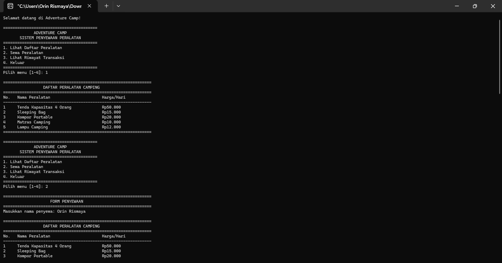
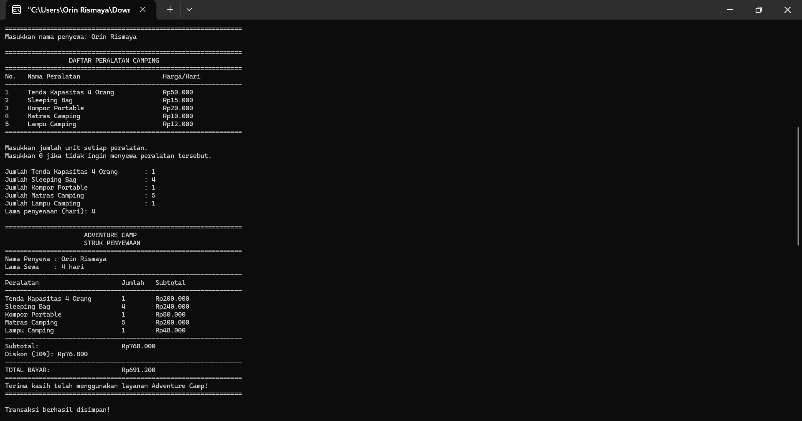
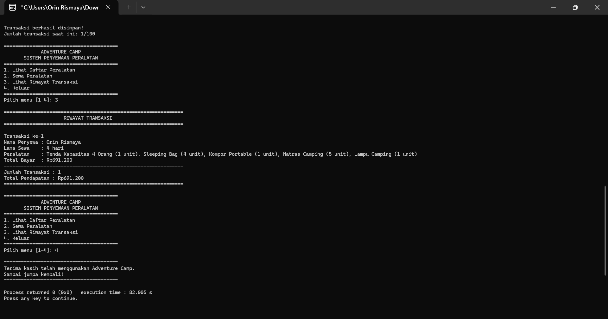

# Adventure Camp

## Aplikasi Penyewaan Peralatan Camping Berbasis Bahasa C

### Identitas Pengembang

- **Nama:** Orin Rismaya
- **NIM:** C2583207046
- **Nama Proyek:** Adventure Camp

## Deskripsi Proyek

Adventure Camp merupakan aplikasi berbasis console yang dikembangkan menggunakan bahasa pemrograman C untuk mengelola penyewaan peralatan camping.

Program ini dirancang untuk memudahkan pengguna dalam melihat daftar peralatan, melakukan penyewaan beberapa jenis barang dalam satu transaksi, menghitung biaya penyewaan secara otomatis, memberikan diskon berdasarkan lama penyewaan, mencetak struk transaksi, serta mencatat riwayat transaksi dan total pendapatan.

## Fitur Program

- Menampilkan daftar peralatan camping.
- Menyewakan beberapa jenis peralatan dalam satu transaksi.
- Menghitung biaya penyewaan secara otomatis.
- Memberikan diskon berdasarkan lama penyewaan.
- Mencetak struk transaksi penyewaan.
- Mencatat riwayat transaksi.
- Menampilkan total pendapatan penyewaan.

## Teknologi yang Digunakan

- Bahasa Pemrograman: C
- Jenis Aplikasi: Console Application
- Compiler: GCC atau compiler C lainnya

## Tampilan Program

### 1. Tampilan Awal Program

### 2. Tampilan Proses Penyewaan

### 3. Tampilan Hasil Transaksi

## Tujuan Proyek

Proyek ini dibuat untuk menerapkan konsep dasar pemrograman bahasa C, seperti penggunaan variabel, percabangan, perulangan, fungsi, pengolahan data, dan perhitungan transaksi dalam sebuah aplikasi penyewaan peralatan camping.

## Pengembang

**Orin Rismaya**

NIM: C2583207046

---

Adventure Camp - Aplikasi Penyewaan Peralatan Camping
